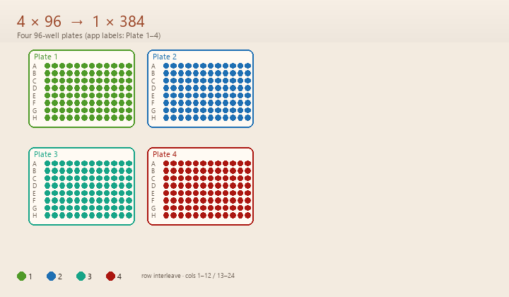

# Аватар — объединитель 4 планшетов

Объединяет четыре 96-луночных планшета в один 384-луночный для Bio-Rad CFX Manager.



Чередование строк (планшеты 1/3 → нечётные строки 384, 2/4 → чётные; 1–2 в колонках 1–12, 3–4 в 13–24). Пересборка GIF: `uv run python docs/media/generate_plate_fold_gif.py`.

## Первый запуск

1. Образец Excel: `src/планшеты соя пробелы.xlsx` — четыре листа, диапазон `B3:M10`.
2. Веб: `uv run python src/run_pipeline.py --web` → карточка **Quick start** на Pipeline → **Use sample Excel** (если файл рядом) → **Run** → папка `Результат N`.
3. Схема складывания: GIF выше (`docs/media/four-to-384.gif`).

## Структура

- `src/` — исходники пайплайна, интерфейса и тестовый Excel-файл.
- `tests/` — pytest-набор для пайплайна, интерфейса и инструментов.
- `dev/` — браузерные E2E-проверки веб-интерфейса.
- `docs/` — каталог генетических решений, дизайн и план.

## Запуск

Требуется `Python 3.13+`. Зависимости и запуск — через `uv`:

```bash
uv sync
uv run python src/run_pipeline.py
```

Рантайм: `Bio.Seq` и `SeqIO` для последовательностей, `Pint` для единиц,
`Primer3-py` для термодинамики, `seqfold` для структуры олиго, `pydna` для ПЦР
in silico, `wellmap` для раскладок, `pandas` и `openpyxl` для таблиц и XLSX,
`NiceGUI` для локального веб-интерфейса.

### Веб-интерфейс

```bash
uv run python src/run_pipeline.py --web
```

Открывается `http://127.0.0.1:8080`: выбор файла и листов, запуск пайплайна,
живой лог, результаты с manifest и все генетические инструменты. Слева —
постоянная панель навигации: Pipeline, Results и все девять инструментов.
Язык переключается кнопками `EN` / `RU` внизу панели (по умолчанию английский;
выбор действует до перезапуска сервера).
Сервер слушает только localhost. Флаги: `--port 8080`, `--no-browser`.

#### Windows: двойной щелчок

В корне репозитория:

| Файл | Действие |
| ---- | -------- |
| `start-web.bat` | запускает веб-UI, подбирает свободный порт (с 8080), открывает браузер; окно консоли озаглавлено **Avatar Combiner — Web UI** |
| `stop-web.bat` | останавливает сервер по PID-файлу и/или порту |

Оставьте окно `start-web.bat` открытым на время работы. Остановка: закрыть
окно, `Ctrl+C` или `stop-web.bat`. PID и порт пишутся в `%TEMP%\avatar-combiner-web.pid`
и `%TEMP%\avatar-combiner-web.port`.

Для исходников bat вызывает `src/launch_web_windows.py` через `uv`. Если есть
собранный `src/dist\*.exe`, он тоже умеет `--web` — отдельный PyInstaller-таргет
не нужен (тот же бинарник + bat). После `build_binary.py` в `src/dist/`
появляются свои `start-web.bat` / `stop-web.bat` рядом с exe.

### Быстрые клавиши

| Клавиша       | Действие                               |
| ------------- | -------------------------------------- |
| `R` / `Enter` | запустить объединение                  |
| `D`           | список папок `Результат N`             |
| `O`           | открыть последний результат            |
| `C`           | настройки: файл Excel, листы, диапазон |
| `T`           | инструменты генетика                   |
| `H`           | помощь (EN/RU)                         |
| `L`           | переключить язык                       |
| `Q`           | выход                                  |
| `↑` / `↓`     | выбор в списке результатов             |
| `B` / `Esc`   | назад                                  |

Справка `H` показывает английский и русский текст рядом на широком терминале.

### Запуск без интерфейса

```bash
uv run python src/run_pipeline.py --no-ui
```

Флаги: `--ui`, `--no-ui`, `--lang en|ru`, `--version`, `--help`.

## Инструменты генетика

`T` открывает экран инструментов:

| Клавиша | Инструмент                                                           |
| ------- | -------------------------------------------------------------------- |
| `1`     | Tm праймера, GC, шпилька, гомодимер                                  |
| `2`     | пара праймеров: Tm, гетеродимер, 3' конец                            |
| `3`     | комплемент, реверс, обратный комплемент                              |
| `4`     | конвертер единиц (bp/kb/Mb, масса, объём, концентрация, температура) |
| `5`     | структура олиго: шпильки, самодимеры, ΔG (seqfold)                   |
| `6`     | проверка раскладки wellmap                                           |
| `7`     | ПЦР in silico (pydna)                                                |
| `8`     | экспорт результата в XLSX                                            |

Ввод: `Enter` подтвердить, `Esc` отмена, `Ctrl+U` очистить.

План развития генетического набора — `docs/genetics-suite-2026.md`: 100
готовых библиотек и сервисов с лицензиями, статусом на 2026 год и оценкой
трудоёмкости. Ничего не пишем с нуля.

## Результаты

При каждом запуске создаётся новая папка `Результат N` рядом с программой.
Повторный запуск создаёт `Результат 2`, затем `Результат 3` и так далее.
Корень программы при этом остаётся чистым. В веб-UI тот же список на странице
Results («What is in «Результат N»»).

| Файл | Назначение |
| ---- | ---------- |
| `plate1.csv` … `plate4.csv` | Лунки каждого выбранного 96-луночного листа (незанятые слоты — пустые) |
| `plate1_column.txt` … `plate4_column.txt` | Те же лунки одним столбцом: A1–A12, B1–B12, … (удобно вставить в Excel) |
| `metadata.csv` | Текст шапки с каждого листа |
| `combined_384_plate.csv` | Все лунки в раскладке 384 со старыми и новыми координатами |
| `combined_384_plate_pivot.csv` | Сетка 16×24 (строки A–P, столбцы 1–24) |
| `combined_384_plate_ids.txt` | Только ID, по одному в строке, порядок A1…P24 |
| `manifest.json` | Паспорт запуска: версия, время, Excel, листы, диапазон |

## Настройка

Файл Excel находится автоматически: программа берёт первый `.xlsx`/`.xlsm` из
своей папки и первые четыре листа. На экране `C`:

| Клавиша | Действие                                         |
| ------- | ------------------------------------------------ |
| `F`     | выбрать файл Excel по номеру из списка или путём |
| `S`     | выбрать четыре листа: номера `1,2,3,4` или имена |
| `R`     | задать диапазон, например `B3:M10`               |
| `O`     | открыть папку программы                          |

`config.json` не нужен. Если он уже лежит рядом, он читается для совместимости.
Каждая папка `Результат N` получает `manifest.json`: версия, время, файл Excel,
листы и диапазон, с которыми сделан запуск.

## Проверка

```bash
uv run pytest
uv run ruff check src tests
```

## Сборка exe

Сборка выполняется только на Windows:

```bash
uv sync --group build
cd src
uv run python build_binary.py
```

Готовый файл появится в `src/dist/`. Рядом соберутся `start-web.bat` и
`stop-web.bat` для запуска веб-UI из exe (`--web`); отдельный PyInstaller-таргет
не нужен. Рантайм и состав сборки описаны в разделе «Запуск»: `pandas`,
`openpyxl` и `NiceGUI` входят в сборку. `matplotlib` и `Pillow` намеренно
исключены (wellmap загружает их только для графиков), тесты и необязательные
модули тоже не входят.

PyInstaller применяет UPX только на Windows; на Linux он отключён из-за проблем совместимости. UPX может
вызывать ложные срабатывания антивируса. На Linux onefile включает libpython,
поэтому размер Linux-бинарника не равен размеру Windows-exe.

## Лицензии

Исходный код распространяется под лицензией MIT — см. файл `LICENSE`.

`Primer3-py` распространяется под GPL-2.0-or-later. Если вы распространяете
собранный exe с ним, действуют обязательства GPL. `Biopython` и `Pint`
распространяются под permissive-лицензиями (Biopython License / BSD).
