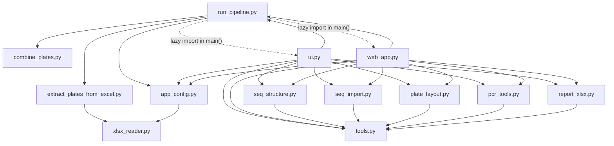

# Static analysis — avatar-combiner

**Commit:** `ad63047` · **Date:** 2026-10-20 · **Scope:** `src/` + `tests/`
**Method:** AST import graph, symbol inventory, duplicated-path comparison,
`ruff`, full `pytest`. Runtime measurements from the frozen build are noted
separately.

> The `/understand` skill could not run: its Zed symlink
> (`/root/development/.agents/skills/understand`) points at a missing
> `.cursor/skills/understand`, and the `@understand-anything/core` plugin is not
> installed. No knowledge-graph JSON or dashboard was produced. This document is
> a deterministic static analysis instead.

## 1. Verdict

- One domain core, **two full presentation stacks**: a 1,656-line terminal UI
  and an 882-line web UI.
- No UI imports the other UI. They are coupled through 8 shared domain modules,
  `run_pipeline.run(...)`, `app_config`, and **duplicated controller/presenter
  logic**.
- **54.7% of all source lines are UI** (2,538 of 4,644). The domain is small; the
  UIs dominate the codebase.
- The duplication is not theoretical. It has already produced two real defects:
  the unit-conversion output disagreed between UIs, and the web tool tabs shared
  closure state, so every tool wrote into the Files tab.
- The strongest architectural seam already exists: `run_pipeline.run(base_dir,
  config, log)`. Everything else in the UIs is re-implemented around it.

## 2. Module map

| Module | LOC | Role | Layer |
|---|---:|---|---|
| `run_pipeline.py` | 249 | CLI entry, result folder, manifest, orchestration | controller |
| `app_config.py` | 167 | workbook discovery, sheet/range selection, config | controller |
| `ui.py` | 1,656 | ANSI terminal UI, prompts, tool screens | presentation |
| `web_app.py` | 882 | NiceGUI pages, forms, uploads, downloads | presentation |
| `tools.py` | 259 | Tm, dimers, DNA transforms, Pint units | domain |
| `seq_structure.py` | 78 | seqfold wrapper | domain |
| `seq_import.py` | 126 | FASTA/GenBank/SnapGene import | domain |
| `plate_layout.py` | 72 | wellmap validation, matplotlib-free loader | domain |
| `pcr_tools.py` | 52 | pydna in-silico PCR | domain |
| `report_xlsx.py` | 80 | CSV → formatted XLSX | domain |
| `extract_plates_from_excel.py` | 191 | workbook → plate CSVs | pipeline |
| `combine_plates.py` | 234 | four 96-well plates → 384 | pipeline |
| `xlsx_reader.py` | 208 | custom XLSX reader | infrastructure |
| `build_binary.py` | 212 | PyInstaller build | infrastructure |
| `fix_cultivar_names.py` | 120 | standalone utility, not imported | orphan |
| `generate_test_plates.py` | 60 | standalone fixture generator, not imported | orphan |

## 3. Dependency graph

- Both UIs import the **same eight** modules: `app_config`, `pcr_tools`,
  `plate_layout`, `report_xlsx`, `run_pipeline`, `seq_import`, `seq_structure`,
  `tools`.
- `run_pipeline` imports `ui` and `web_app` only inside `main()` (`--web`/TUI
  dispatch), so there is no import-time cycle.
- `run_pipeline`'s domain imports sit in a module-level `try` block
  (`run_pipeline.py:14-21`) and call `sys.exit(1)` on failure — library-hostile
  and invisible to a naive top-level import scan.

## 4. CLI ↔ web coupling

The UIs do not call each other. They are coupled by **parallel implementations
of the same user journey** on top of the same domain.

| Concern | Terminal UI | Web UI | Shared? |
|---|---|---|---|
| Workbook / sheets / range | `render_config` 856, `edit_excel` 1517, `edit_sheets` 1537, `edit_range` 1581 | `State.apply` 334, page form 423-560 | `app_config` only |
| Validation errors | local `ToolError` handling | `ui.notify` + `safe_show` | no shared presenter |
| Run trigger | `do_run` 1429 | `run_now` 529 | `run_pipeline.run` |
| Progress | `on_log` 1475, `render_run` 1296 | `state.logs` + 0.3 s timer 545 | no shared log model |
| Result discovery | `_load_results` 1619 | `results_page` 567 | duplicated scanner |
| Manifest | written by pipeline | downloaded/viewed by page | `run_pipeline` |
| Nine tools | `tool_*` 1039-1245 | panels 645-780 + formatters 783-869 | domain only |
| i18n | `TEXT` 100 keys ×2 | `TEXTS` 66 keys ×2 | duplicated dictionaries |
| File import | `tool_import` 1163 | upload handler 507 | `seq_import` |
| XLSX export | `tool_xlsx` 1231 | export button 757 | `report_xlsx` |

**Tool-by-tool parity**

| Tool | TUI handler | Web panel | Shared logic |
|---|---|---|---|
| Primer Tm | 1039 | 645 | `tools.analyze_primer` |
| Primer pair | 1058 | 656 | `tools.analyze_pair` |
| DNA transforms | 1092 | 670 | `tools.*` |
| Units | 1120 | 678 | `tools.convert_text` |
| Structure | 1138 | 695 | `seq_structure` |
| Import | 1163 | 727 | `seq_import` |
| Layout | 1186 | 727 | `plate_layout` |
| PCR | 1205 | 708 | `pcr_tools` |
| XLSX | 1231 | 727 | `report_xlsx` |

Each row has its own result formatting and error presentation. That is where
the unit-order drift came from: `nM 25000` vs `25000 nM`.

## 5. Findings

### F1 — High: duplicated presentation/controller logic

**Evidence:** TUI tools `ui.py:1039-1245` (207 lines), web panels
`web_app.py:645-780` plus formatters `783-869` (222 lines); config UIs
`ui.py:1517-1597` vs `web_app.py:334,423-560`; results scanners
`ui.py:1619-1648` vs `web_app.py:567-586`.

**Impact:** every tool change must be made twice, with different formatting and
error paths. Already observed: unit output order differed; the web tab closure
bug shipped because each panel rebuilt the same handler shape by hand.

**Fix:** a pure `tool_service` returning typed results, plus per-UI presenters.
See §6.

### F2 — High: web state is global, not per client

**Evidence:** `web_app.py:37` (`LANG = {'code': 'en'}`), `web_app.py:347`
(`state = State(base_dir)` once per app), `state.running` at 529-563.

**Impact:** two browser tabs share workbook selection, sheets, language and the
running flag. Tab A switching to Russian changes Tab B; Tab B clicking Run while
A runs silently does nothing. Acceptable only under a strict single-user,
single-tab assumption, which is not stated in the UI.

**Fix:** move selection/language into `app.storage.user` (requires
`storage_secret`) or a per-client state object; keep only the pipeline lock
global.

### F3 — High: result folder and manifest are created before validation

**Evidence:** `run_pipeline.py:136-138` creates `Результат N` and writes
`manifest.json`; the Excel check happens at 143; the missing-file branch
(162-168) logs and then **still** calls `combine_plates.main(input_dir=base_dir)`
at 174-179.

**Impact:** a run with a missing/unreadable workbook still leaves a result
folder with a manifest. Worse, it combines whatever `plate1-4.csv` happen to sit
in the program folder, so stale data can be presented as a fresh 384-well
plate.

**Fix:** validate workbook + sheets + range before `create_result_dir`; when the
workbook is missing, abort with a non-zero result and create nothing.

### F4 — Medium: `config.json` is trusted without validation

**Evidence:** `app_config.py:111-114` returns `json.load(...)` unchanged;
`extract_plates_from_excel.py:46` indexes `config['data_range']` directly.

**Impact:** an old or hand-edited JSON missing `data_range`/`sheets` raises
`KeyError`, presented as a generic pipeline failure rather than a config error.

**Fix:** a `schema`/`validate_config` step in `app_config`, applied to both the
JSON and auto-built configs; normalize defaults before any consumer sees it.

### F5 — Medium: two XLSX stacks

**Evidence:** pipeline reads workbooks with `xlsx_reader.py` (208 lines, stdlib
XML/zip); export uses pandas/openpyxl (`report_xlsx.py:56-78`).

**Impact:** two behaviours for merged cells, formulas, inline strings, date
formats, and .xlsm. Bug fixes must land twice; the custom reader still exists
even though openpyxl is now a runtime dependency.

**Fix:** either keep the custom reader as the only reader and state why, or
replace it with openpyxl `read_only=True, data_only=True` and delete 200 lines.

### F6 — Medium: duplicated i18n with drift

**Evidence:** `ui.py` `TEXT` (100 keys per language) vs `web_app.py` `TEXTS`
(66 keys per language); names already differ: “Genetics tools” vs “Genetics”,
“Import sequence file” vs “Import sequence”, “Complement / reverse complement”
vs “DNA”.

**Impact:** Russian/English coverage diverges; a web label and its TUI
counterpart describe the same action differently.

**Fix:** shared `i18n.py` for domain/tool names; UI-specific keys stay local but
reference shared values.

### F7 — Medium: dead code and orphan modules

**Evidence:** `app_config.update_sheets` (146) unused; `App.config_source`
assigned at `ui.py:637,646` never read; unused keys `sheets_hint` (178/280),
`range_hint` (179/281), `ids` (185/287); `fix_cultivar_names.py` and
`generate_test_plates.py` are imported by nothing.

**Impact:** readers cannot tell supported behaviour from leftovers; test
coverage questions focus on dead paths.

**Fix:** delete or wire up. Orphan utilities belong in `tools/` or `scripts/`,
not beside runtime modules.

### F8 — Medium: packaging depends on internals and manual lists

**Evidence:** `plate_layout.py:43-72` stubs `wellmap.plot` and imports
`wellmap.file`; `build_binary.py:85-114` is a hand-maintained hidden-import
list; dependency floors are open (`wellmap>=3.5.2`, `nicegui>=3.18.0`).

**Impact:** a wellmap refactor breaks the frozen Web/TUI at runtime; a new
module can be forgotten in the hidden-import list. Bounds allow a major
version to change APIs silently.

**Fix:** pin `wellmap<4`, `nicegui<4`; add a smoke test that freezes every tool
entry point; generate hidden imports from the local import graph where possible.

### F9 — Low: broad exception handling hides programming errors

**Evidence:** 16 `except Exception` in `ui.py`, 6 in `web_app.py` (e.g. 500,
516, 536, 553, 602), 2 in `run_pipeline.py`.

**Impact:** domain errors and coding mistakes look identical to the user.
The closure bug surfaced as a friendly “sequence is empty”, not as a defect.

**Fix:** catch `ToolError`/`ConfigError`/`OSError` explicitly; log unexpected
exceptions with a traceback.

### F10 — Low: uploads accumulate and are never validated

**Evidence:** `web_app.py:314-319` (`<base>/.uploads`), 507-514 (write by
name), 450 (50 MB cap).

**Impact:** disk growth; arbitrary file types land in the app folder and appear
in the workbook picker only when `.xlsx`/`.xlsm`.

**Fix:** temporary per-run directory, extension whitelist, cleanup on exit.

### F11 — Low: pipeline uses `sys.exit` as a library

**Evidence:** `run_pipeline.py:126,161,183`; `extract_plates_from_excel.py`
`read_config` exits on JSON errors.

**Impact:** callers must catch `SystemExit`; a future non-CLI caller (API,
batch runner) inherits process-exit semantics.

**Fix:** raise `PipelineError`; let `main()` translate it to exit codes.

### F12 — Low: config loading exists twice

**Evidence:** `run_pipeline.read_config` (66) and `app_config.load_config` (104)
both open `config.json`, with different error behaviour.

**Impact:** two definitions of “valid config”; fixes land in one path only.

**Fix:** one loader, one error type.

## 6. Refactor seams (ordered)

| Step | Change | Files | Cost | Payoff |
|---|---|---|---|---|
| 1 | Validate workbook/sheets/range before creating the result folder | `run_pipeline.py` | S | Removes stale-output class of bugs |
| 2 | `tool_service.py`: pure functions returning dataclasses for all 9 tools | new, `ui.py`, `web_app.py` | M | One implementation per tool |
| 3 | Per-UI presenters for text vs structured output | new | M | Formatting can differ by design, not by accident |
| 4 | Shared `i18n.py` for tool/domain names | new, both UIs | M | No label drift |
| 5 | `controller.py`: selection state + `prepare()/run()` used by both UIs | new | L | Deletes duplicate controller code |
| 6 | Pin dependency majors; build smoke test | `pyproject.toml`, `build_binary.py` | S | Frozen-build confidence |
| 7 | Delete dead code/orphans | several | S | Smaller surface |

**Suggested first PR:** steps 1 + 7. Small, independently testable, and removes
the highest-impact correctness risk.

**Suggested second PR:** step 2 for the five sequence-only tools (Tm, pair,
DNA, units, structure), then import/layout/PCR/XLSX.

## 7. Verification

- `uv run pytest -q` → **82 passed**
- `uv run ruff check src tests` → **clean**
- Frozen build: `src/dist/avatar_combiner`, 62 MB, Web pages 200
- UI integration tests: `tests/test_web_ui.py` (NiceGUI user simulation,
  including real Tm and Units clicks), `tests/test_ui.py` (TUI render/navigation)

## 9. Remediation status

Implemented in `0641470`. The original analysis above is pinned to `ad63047`;
this table is the current state.

| ID | Status | What changed |
|---|---|---|
| F1 | **Open** | Tool/config presentation is still duplicated. Needs the shared `tool_service` + presenter layer from §6. |
| F2 | **Fixed** | Web config and language live in `app.storage.user` (per client); run logs are per page. `state.running` stays a single global pipeline lock by design. |
| F3 | **Fixed** | `run_pipeline.run` validates the workbook, sheets and range before `create_result_dir`. A missing workbook raises `PipelineError` and creates no folder. Regression tests pin it. |
| F4 | **Fixed** | `app_config.validate_config` checks workbook, four unique sheets, range bounds and label rows; both JSON and auto configs go through it. |
| F5 | **Fixed** | Custom `xlsx_reader.py` (208 lines) deleted. Input and export both use openpyxl, imported lazily so TUI startup stays light. |
| F6 | **Open** | `TEXT` and `TEXTS` are still separate dictionaries. Needs the shared i18n module from §6. |
| F7 | **Fixed** | `update_sheets`, `config_source`, `sheets_hint`, `range_hint` and `ids` removed. The two standalone scripts remain as utilities; neither is imported or bundled. |
| F8 | **Fixed** | Local hidden imports are generated from the AST import graph (`collect_local_modules`), with a test; `wellmap` is pinned to the exact version whose internals the loader uses; other majors remain bounded. |
| F9 | **Fixed** | UI catches now name expected types (`ToolError`, `ConfigError`, `OSError`, `ValueError`, `ImportError`); pipeline boundaries add the exception class to the message. Remaining broad catches are deliberate: Windows ANSI setup, desktop opening, and storage access without a client context. |
| F10 | **Fixed** | Uploads must be `.xlsx`/`.xlsm`; 50 MB cap; files older than 7 days are pruned at startup. |
| F11 | **Fixed** | `run()` raises instead of exiting; `main()` maps `PipelineError` to exit code 1; extractor raises `FileNotFoundError`/`ValueError`. |
| F12 | **Fixed** | `read_config` removed from both `run_pipeline` and the extractor; `app_config.load_config` is the only loader. |

### Verification after remediation

- `uv run pytest -q` → **82 passed**
- `uv run ruff check src tests` → clean
- Frozen run with workbook → exit 0, 8 result files + `manifest.json`
- Frozen run with workbook removed → exit 1, **no** result folder
- Frozen web → `/`, `/tools?tool=units`, `/results` all 200
- Bundle: 62 MB

**Still open:** F1 (duplicated tool/config presentation) and F6 (duplicated
i18n). Both are architectural and should land as separate PRs from §6; they do
not affect current correctness.

## 10. Limitations

- Static analysis only; no runtime profiling, no mutation testing.
- Line numbers are pinned to `ad63047`.
- The custom XLSX reader was not fuzzed; finding F5 is about duplication and
  consistency, not proven parser defects.
- Multi-tab behaviour in F2 is inferred from module-level state; it was not
  exercised with two live browsers.
